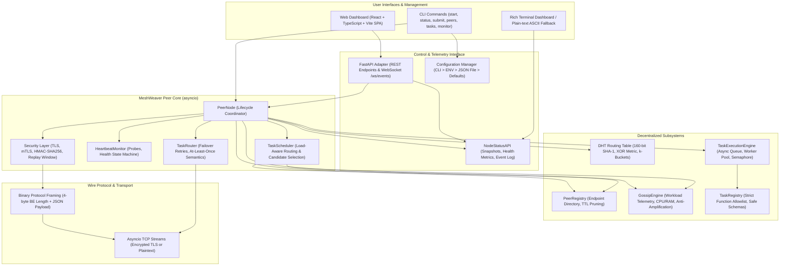

# MeshWeaver: Zero-Dependency P2P Async Task Broker

[](https://www.python.org/)
[](#architecture-overview)
[](LICENSE)
[-brightgreen.svg)](#four-week-implementation-roadmap)

MeshWeaver is an educational, zero-dependency peer-to-peer asynchronous task broker implemented in Python 3.11+. It demonstrates decentralized peer discovery, workload telemetry propagation, load-aware task routing, and resilient fault recovery without requiring central coordination services such as Redis, RabbitMQ, or Celery.

---

## Table of Contents

1. [Why MeshWeaver?](#why-meshweaver)
2. [Core Design Principles](#core-design-principles)
3. [Architecture Overview](#architecture-overview)
4. [Supported Features](#supported-features)
5. [Module Breakdown](#module-breakdown)
6. [Installation & Dependencies](#installation--dependencies)
7. [Quick-Start Guide](#quick-start-guide)
8. [Multi-Node Local Demonstrations](#multi-node-local-demonstrations)
9. [CLI Usage Reference](#cli-usage-reference)
10. [Configuration Management & Environment Variables](#configuration-management--environment-variables)
11. [Interactive Dashboards & Web UI](#interactive-dashboards--web-ui)
12. [Testing Guide](#testing-guide)
13. [Troubleshooting](#troubleshooting)
14. [Security Boundaries & Threat Model](#security-boundaries--threat-model)
15. [Current Limitations](#current-limitations)
16. [Four-Week Implementation Roadmap](#four-week-implementation-roadmap)
17. [Contributing & License](#contributing--license)

---

## Why MeshWeaver?

Traditional distributed task queues (e.g., Celery with Redis or RabbitMQ) rely on a central broker to hold task queues, coordinate worker registries, and monitor heartbeats. While mature, centralized architectures introduce:
- **Single Points of Failure (SPOF)**: A broker crash halts all task distribution across the cluster.
- **Operational Infrastructure Overhead**: Running, configuring, securing, and scaling standalone broker clusters.
- **Network Inefficiencies**: All task requests and worker heartbeats must funnel through a central choke point, even between adjacent edge devices.

MeshWeaver explores a peer-to-peer alternative designed for edge computing, local ad-hoc clusters, and educational exploration. Nodes self-organize, discover neighboring workers, continuously exchange workload telemetry via epidemic gossip, dynamically route tasks to the least-loaded healthy peers, and automatically fail over when peers drop off the network.

---

## Core Design Principles

1. **Zero External Runtime Dependencies**: MeshWeaver's core peer networking, Kademlia DHT, gossip engine, task scheduler, and security layers operate entirely on the Python Standard Library (`asyncio`, `socket`, `ssl`, `hmac`, `hashlib`, `json`, `dataclasses`, `logging`).
2. **Strict Safety & Execution Boundaries**: Arbitrary remote code execution (RCE) via `pickle`, `eval`, `exec`, dynamic imports, or bytecode compilation is strictly prohibited. Only functions explicitly registered in a node's local `TaskRegistry` may execute.
3. **Deterministic Mathematical Foundations**: Peer topology and addressing leverage a 160-bit SHA-1 keyspace and the bitwise XOR distance metric ($d(x, y) = x \oplus y$), guaranteeing triangle inequality, unidirectionality, and loop-free routing.
4. **Resilient Failure Tolerance**: Network timeouts, crashed workers, and stale records are handled gracefully through active heartbeat monitoring, fast sub-millisecond socket-drop detection, and bounded candidate failover retry under at-least-once execution semantics.
5. **Decoupled Asynchronous Core**: Networking, discovery, gossip, execution, and scheduling coroutines operate concurrently over structured interfaces without blocking the asyncio event loop.

---

## Architecture Overview

MeshWeaver employs a modular seven-layer architecture. Each layer communicates through typed data structures and asynchronous queues.



For complete technical specifications, binary wire framing formats, Kademlia iterative lookup pseudocode, and mathematical proofs, see [docs/ARCHITECTURE.md](docs/ARCHITECTURE.md).

---

## Supported Features

| Feature Subsystem | Status | Highlights |
|---|---|---|
| **Async Networking** | Production-Ready | Non-blocking `asyncio` TCP client/server, connection pooling, handshake negotiation, correlated request-response matching. |
| **Binary Protocol Framing** | Production-Ready | Length-prefixed wire framing (4-byte big-endian length + JSON envelope), 10 MiB frame limit, DoS payload protection. |
| **Dynamic Peer Registry** | Production-Ready | Local endpoint registry tracking peers by unique `NodeID`, health states (`ACTIVE`, `STALE`, `EXPIRED`), collision handling, and TTL expiration. |
| **Kademlia-Inspired DHT** | Production-Ready | 160-bit SHA-1 keyspace, bitwise XOR distance metric, 160-bucket `RoutingTable` with LRU eviction and replacement caching, bounded iterative lookups with timeouts. |
| **Workload Telemetry (Gossip)** | Production-Ready | Epidemic gossip protocol disseminating CPU percent, memory percent, active task count, health status, monotonic timestamps, fanout bounds, and hop counters. |
| **Local Task Execution Engine** | Production-Ready | Standalone `TaskExecutionEngine` with `asyncio.Queue`, worker pool concurrency control (`max_concurrency`), strict lifecycle states (`PENDING`, `RUNNING`, `COMPLETED`, `FAILED`, `CANCELLED`), task cancellation. |
| **Standalone Task Worker** | Production-Ready | `TaskWorker` supporting asynchronous and synchronous tasks in threadpools, execution timeout bounds, structured exception handling (`TaskErrorInfo`), and safe error encapsulation. |
| **Load-Aware Task Scheduling** | Production-Ready | Composite load scoring evaluating active tasks (weight 10.0), CPU% (0.5), memory% (0.5), and health penalties. Deterministic XOR tie-breaking and explainability (`explain()`). |
| **Fault Recovery & Failover** | Production-Ready | Active heartbeat probes (`HeartbeatMonitor`), health state transitions (`HEALTHY` -> `DEGRADED` -> `UNHEALTHY`), instant TCP disconnect detection, bounded retries under at-least-once execution semantics. |
| **Peer Security & Auth** | Production-Ready | TLS 1.2+ encryption, mutual TLS (mTLS), HMAC-SHA256 message signing/integrity, bearer token authentication, peer allowlists, sliding replay window (60s), DoS size bounds. |
| **Terminal Dashboard (TUI)** | Production-Ready | Live interactive Rich terminal dashboard with peer health tables, CPU/RAM bars, active tasks, failure tracking, and automatic clean plain-text ASCII fallback. |
| **Unified Configuration** | Production-Ready | Multi-layer resolution: CLI Arguments > Environment Variables (`MESHWEAVER_*`) > Configuration File (`meshweaver.example.json`) > Defaults, with human-readable diagnostic error reporting. |
| **Web Dashboard & API** | Production-Ready | FastAPI REST API, live WebSocket telemetry stream (`/ws/events`), React 18 + TypeScript + Vite SPA with light theme and interactive network topology graph. |

---

## Module Breakdown

All source code resides under `src/meshweaver/`. Every module has targeted unit and integration tests under `tests/`.

| Module | Primary Responsibilities | Key Classes / Functions |
|---|---|---|
| [`protocol.py`](src/meshweaver/protocol.py) | Wire message framing, length-prefix serialization, frame size enforcement, protocol versions. | `Message`, `MessageType`, `read_message`, `write_message`, `MAX_FRAME_SIZE` |
| [`network.py`](src/meshweaver/network.py) | Async TCP stream handling, dynamic port binding, handshake negotiation, request routing, mesh lifecycle. | `PeerNode`, `PeerConnection`, `join_mesh`, `leave_mesh`, `submit_task` |
| [`peers.py`](src/meshweaver/peers.py) | Peer identification, network endpoint representations, state machine, registry TTL pruning. | `PeerRecord`, `PeerEndpoint`, `PeerRegistry`, `PeerState` |
| [`dht.py`](src/meshweaver/dht.py) | 160-bit keyspace, bitwise XOR distance calculation, $k$-bucket routing table, iterative lookup engine. | `NodeID`, `xor_distance`, `KBucket`, `RoutingTable`, `IterativeLookup` |
| [`gossip.py`](src/meshweaver/gossip.py) | Epidemic workload dissemination, system telemetry collection, monotonic freshness, anti-amplification. | `GossipEngine`, `GossipStore`, `ResourceCollector`, `NodeResourceReport` |
| [`execution.py`](src/meshweaver/execution.py) | Local asynchronous task engine, worker pool concurrency control, lifecycle states, cancellation. | `TaskExecutionEngine`, `TaskRecord`, `TaskState` |
| [`worker.py`](src/meshweaver/worker.py) | Independent task worker, envelope validation, execution timeout boundaries, threadpool offloading. | `TaskWorker`, `TaskEnvelope`, `TaskResult`, `TaskLifecycleState` |
| [`tasks.py`](src/meshweaver/tasks.py) | Task request/response schemas, task function registry, strict allowlisting, error encapsulation. | `TaskRequest`, `TaskResponse`, `TaskRegistry`, `TaskErrorInfo`, `TaskStatus` |
| [`routing.py`](src/meshweaver/routing.py) | Load-aware task routing, candidate peer ranking, automatic failover retries. | `TaskRouter`, `LoadAwareRoutingStrategy`, `RoutingDecision` |
| [`scheduler.py`](src/meshweaver/scheduler.py) | Decentralized load-aware scheduling, composite score ranking, health penalty integration, explainability. | `TaskScheduler`, `LoadAwareScheduler`, `SchedulerConfig`, `SchedulingDecision` |
| [`heartbeat.py`](src/meshweaver/heartbeat.py) | Active heartbeat probe loop, probe timeouts, latency tracking (RTT), peer health state machine. | `HeartbeatMonitor`, `HeartbeatConfig`, `HealthStatus` |
| [`security.py`](src/meshweaver/security.py) | Transport encryption (TLS/mTLS), HMAC-SHA256 message signing, replay cache, bearer token auth. | `SecurityConfig`, `TLSConfig`, `ReplayCache`, `build_ssl_context`, `verify_signature` |
| [`status.py`](src/meshweaver/status.py) | Observability service, health snapshots, structured logging formatters. | `NodeStatusAPI`, `NodeStatusSnapshot`, `PeerStatus`, `setup_structured_logging` |
| [`cli_dashboard.py`](src/meshweaver/cli_dashboard.py) | Rich terminal monitoring dashboard, snapshot generation, table formatters, plain-text ASCII fallback. | `run_live_dashboard`, `render_rich_dashboard`, `render_plain_text_dashboard` |
| [`config.py`](src/meshweaver/config.py) | Unified configuration resolution, environment-variable parsing, JSON file loading, semantic validation. | `NodeConfig`, `resolve_node_config`, `load_env_config`, `load_config_file` |
| [`exceptions.py`](src/meshweaver/exceptions.py) | Domain exception hierarchy rooted in `MeshWeaverError`. | `ConfigurationError`, `NetworkError`, `SecurityError`, `TaskError` |
| [`__main__.py`](src/meshweaver/__main__.py) | CLI argument parsing and command dispatch (`start`, `status`, `submit`, `peers`, `tasks`, `monitor`, `dashboard`, `demo`). | `main` |
| [`__init__.py`](src/meshweaver/__init__.py) | Public package exports, version definition (`__version__ = "0.1.0"`). | All primary classes and types |

---

## Installation & Dependencies

MeshWeaver requires **Python 3.11** or later.

### 1. Create a Clean Virtual Environment

```bash
# Clone the repository
git clone https://github.com/vishesh-hembrom/meshweaver-p2p-async-task-broker.git
cd meshweaver-p2p-async-task-broker

# Create virtual environment
python -m venv .venv
```

Activate the environment:

**Windows PowerShell:**
```powershell
.venv\Scripts\Activate.ps1
```

**macOS / Linux:**
```bash
source .venv/bin/activate
```

### 2. Dependency Philosophy & Optional Extras

MeshWeaver has **zero required external runtime dependencies**. The core package operates entirely within the Python Standard Library. Optional extras provide enhanced capabilities:

| Extra | Dependencies | Purpose | Fallback when Omitted |
|---|---|---|---|
| *(none / core)* | *(none)* | Core P2P networking, DHT discovery, task routing, security, and execution. | Standard library (`socket`, `ssl`, `hmac`, `asyncio`). |
| `cli` | `rich>=13.0.0` | Live interactive terminal dashboard widgets and colored status displays. | Clean plain-text ASCII table output. |
| `security` | `cryptography>=42.0.0` | Advanced X.509 certificate generation, inspection, and verification. | Standard library `ssl` and `hmac` modules. |
| `metrics` | `psutil>=5.9.0` | High-fidelity hardware resource monitoring (per-core CPU, memory swap). | Native OS primitives (`ctypes` on Windows, `/proc` on Linux). |
| `dev` | `pytest>=8.0.0`, `pytest-asyncio>=0.23.0`, `ruff>=0.4.0`, `mypy>=1.10.0` | Testing, linting, and static type checking. | N/A |
| `all` | `rich`, `cryptography`, `psutil` | Installs all optional runtime extras for production and CLI monitoring. | N/A |

### 3. Editable Installation

```bash
# Upgrade pip
python -m pip install -U pip

# Full installation with all runtime extras:
pip install -e ".[all]"

# Or minimal zero-dependency installation:
pip install -e .
```

After installation, the `meshweaver` command-line executable is registered and ready:
```bash
meshweaver --version
meshweaver --help
```

*(Note: You can also invoke the entry point directly via `python -m meshweaver`.)*

---

## Quick-Start Guide

Get up and running with MeshWeaver in under 60 seconds:

```bash
# 1. Run the built-in two-peer handshake and task execution demonstration
python -m meshweaver --demo

# 2. Start a persistent local peer node on port 8001
meshweaver start --port 8001 --peer-id quickstart-seed

# 3. In another terminal, inspect the node status
meshweaver status --seeds 127.0.0.1:8001

# 4. Submit an allowlisted task to the running node
meshweaver submit add 15 27 --seeds 127.0.0.1:8001

# 5. Launch the live terminal monitoring dashboard
meshweaver monitor --seeds 127.0.0.1:8001
```

---

## Multi-Node Local Demonstrations

MeshWeaver includes self-contained example scripts in `examples/` demonstrating decentralized multi-node workflows:

### Automated Demonstration Scripts

```bash
# 1. Multi-Node Discovery & Gossip (Bootstrap + 2 Workers)
# Demonstrates dynamic port binding, bootstrap discovery, DHT iterative lookup,
# gossip workload exchange, status snapshots, and graceful departure.
python examples/multi_node.py

# 2. End-to-End Remote Task Execution & Worker Failover
# Demonstrates 4-node cluster (Seed + 2 Compute Workers + Client), load-aware routing,
# duplicate submission deduplication, request timeouts, and automatic failover retry upon worker crash.
python examples/remote_tasks.py

# 3. Load-Aware Scheduling Evaluation
# Demonstrates composite scoring (active tasks, CPU%, RAM%, health penalty),
# deterministic XOR tie-breaking, and rejection of stale/unhealthy nodes.
python examples/load_aware_scheduling.py

# 4. Local Task Worker Execution Engine
# Demonstrates TaskWorker processing validated TaskEnvelope envelopes, execution timeouts,
# threadpool isolation for synchronous tasks, and strict rejection of unauthorized code.
python examples/task_worker_execution.py

# 5. Local Task Execution Engine
# Demonstrates standalone TaskExecutionEngine running an asyncio queue with concurrency limits,
# task lifecycle transitions (PENDING -> RUNNING -> COMPLETED/FAILED/CANCELLED), and cancellation.
python examples/local_task_execution.py
```

### Manual Multi-Terminal Cluster Walkthrough

You can start independent nodes in separate terminal windows to observe decentralized coordination:

```bash
# Terminal 1: Start Bootstrap Seed Node
meshweaver start --host 127.0.0.1 --port 8001 --peer-id seed-node

# Terminal 2: Start Compute Worker Alpha (joining seed)
meshweaver start --host 127.0.0.1 --port 8002 --peer-id worker-alpha --seeds 127.0.0.1:8001

# Terminal 3: Start Compute Worker Beta (joining seed)
meshweaver start --host 127.0.0.1 --port 8003 --peer-id worker-beta --seeds 127.0.0.1:8001

# Terminal 4: Launch Live Rich Terminal Dashboard
meshweaver monitor --seeds 127.0.0.1:8001

# Terminal 5: Submit Tasks
meshweaver submit add 100 250 --seeds 127.0.0.1:8001
meshweaver submit reverse_string "MeshWeaver Decentralized" --seeds 127.0.0.1:8001
```

---

## CLI Usage Reference

The `meshweaver` command line tool provides subcommands for node operations, cluster monitoring, task submission, and diagnostics.

### Subcommand Overview

```text
usage: meshweaver [-h] [--config CONFIG_PATH] [--status] [--host HOST] [--port PORT]
                  [--peer-id PEER_ID] [--seeds SEEDS] [--json] [--timeout TIMEOUT]
                  [--verbose] [-v]
                  {status,demo,submit,start,node,peers,list-peers,peer-list,
                   tasks,task,task-status,monitor,tui,dashboard,web,ui} ...
```

### 1. `meshweaver start` (alias: `node`)
Starts a persistent MeshWeaver peer node to serve tasks and participate in gossip.

```bash
# Start on dynamic port
meshweaver start

# Start on fixed port with seeds and peer ID
meshweaver start --port 8001 --peer-id worker-01 --seeds 127.0.0.1:8000

# Start with live Rich terminal monitoring dashboard embedded
meshweaver start --port 8001 --dashboard

# Start with security parameters (TLS + HMAC + Token)
meshweaver start --port 8001 --tls --cert certs/server.pem --key certs/server.key \
                 --shared-secret "cluster-secret-key" --auth-token "bearer-token-123"
```

| Flag | Description | Default |
|---|---|---|
| `--host HOST` | Local network host interface | `127.0.0.1` |
| `--port PORT` | Local TCP port to bind (`0` for dynamic) | `0` |
| `--peer-id PEER_ID` | Custom node/peer identifier | `node-<timestamp>` |
| `--seeds SEEDS` | Comma-separated bootstrap seed peer endpoints | None |
| `--duration DURATION` | Optional run duration in seconds before auto-stopping | Indefinite |
| `--dashboard`, `--tui` | Launch embedded live Rich terminal monitoring dashboard | `false` |
| `--refresh-rate SEC` | Live dashboard refresh interval in seconds | `1.0` |
| `--plain` | Force plain-text ASCII output without Rich formatting | `false` |
| `--config PATH` | Path to JSON configuration file | None |
| `--verbose` | Enable debug logging | `false` |

### 2. `meshweaver status`
Prints local node status and discovered mesh peer summaries.

```bash
# Print formatted ASCII table
meshweaver status

# Emit clean structured JSON
meshweaver status --json

# Query mesh status via bootstrap seed node
meshweaver status --seeds 127.0.0.1:8001
```

### 3. `meshweaver submit <task_name> [task_args...]`
Submits an allowlisted task for load-aware routing and remote execution across the mesh.

```bash
# Submit arithmetic addition task
meshweaver submit add 125 375 --seeds 127.0.0.1:8001

# Submit string reversal task
meshweaver submit reverse_string "MeshWeaver" --seeds 127.0.0.1:8001

# Output task response as structured JSON
meshweaver submit add 10 20 --seeds 127.0.0.1:8001 --json
```

### 4. `meshweaver peers` (aliases: `list-peers`, `peer-list`)
Discovers and lists known mesh peers, network endpoints, health states, and resource metrics.

```bash
# Display formatted peers table
meshweaver peers --seeds 127.0.0.1:8001

# Output peers list in JSON format
meshweaver peers --seeds 127.0.0.1:8001 --json

# Force plain-text ASCII output
meshweaver peers --seeds 127.0.0.1:8001 --plain
```

### 5. `meshweaver tasks` (aliases: `task`, `task-status`)
Inspects active running tasks, recent results, and execution failures across the mesh.

```bash
# List all active and recent tasks
meshweaver tasks --seeds 127.0.0.1:8001

# Query a specific task ID
meshweaver tasks task-9812a4b --seeds 127.0.0.1:8001

# Output task records in JSON format
meshweaver tasks --seeds 127.0.0.1:8001 --json
```

### 6. `meshweaver monitor` (alias: `tui`)
Launches the live interactive Rich terminal monitoring dashboard.

```bash
# Monitor mesh cluster via seeds
meshweaver monitor --seeds 127.0.0.1:8001

# Custom refresh interval and duration
meshweaver monitor --seeds 127.0.0.1:8001 --refresh-rate 0.5 --duration 60

# Force plain-text ASCII output
meshweaver monitor --seeds 127.0.0.1:8001 --plain
```

### 7. Common Security Flags (Supported across all subcommands)

| Flag | Description | Default |
|---|---|---|
| `--tls` | Enable TLS transport encryption | `false` |
| `--cert PATH` | Path to X.509 certificate PEM file | None |
| `--key PATH` | Path to private key PEM file | None |
| `--ca PATH` | Path to trusted CA certificate PEM file | None |
| `--require-client-cert` | Require peer client certificate (mTLS) | `false` |
| `--shared-secret SECRET` | Pre-shared HMAC secret for message integrity | None |
| `--auth-token TOKEN` | Pre-shared bearer authentication token | None |
| `--allowed-peers PEERS` | Comma-separated peer ID allowlist | None |

---

## Configuration Management & Environment Variables

MeshWeaver enforces a strict priority hierarchy for all configuration values:

$$\text{CLI Arguments} > \text{Environment Variables} > \text{Configuration File} > \text{Built-in Defaults}$$

### Example Configuration File (`meshweaver.example.json`)

Pass a configuration file to any command via `--config <path>`:

```json
{
  "network": {
    "host": "127.0.0.1",
    "port": 8000,
    "peer_id": "mesh-node-01",
    "connection_timeout": 5.0
  },
  "seeds": [
    "127.0.0.1:8001",
    "127.0.0.1:8002"
  ],
  "heartbeat": {
    "interval": 1.0,
    "missed_threshold": 3
  },
  "gossip": {
    "interval": 5.0
  },
  "security": {
    "tls": {
      "enabled": false,
      "certfile": null,
      "keyfile": null,
      "cafile": null,
      "require_client_cert": false,
      "check_hostname": true
    },
    "shared_secret": null,
    "auth_token": null,
    "allowed_peers": []
  },
  "logging": {
    "verbose": false,
    "as_json": false
  }
}
```

### Environment Variable Reference

All core node settings can be managed via environment variables prefixed with `MESHWEAVER_`:

| Environment Variable | Description | Built-in Default |
|---|---|---|
| `MESHWEAVER_CONFIG` | Path to JSON configuration file | None |
| `MESHWEAVER_HOST` | Network host interface | `127.0.0.1` |
| `MESHWEAVER_PORT` | Local network port to bind | `0` (dynamic) |
| `MESHWEAVER_PEER_ID` | Node peer identifier | Generated |
| `MESHWEAVER_SEEDS` | Comma-separated seed endpoints (`host:port`) | None |
| `MESHWEAVER_TIMEOUT` | Connection/discovery timeout in seconds | `5.0` |
| `MESHWEAVER_HEARTBEAT_INTERVAL` | Heartbeat probe interval in seconds | `1.0` |
| `MESHWEAVER_MISSED_THRESHOLD` | Missed heartbeats before peer failure | `3` |
| `MESHWEAVER_GOSSIP_INTERVAL` | Gossip metrics dissemination interval in seconds | `5.0` |
| `MESHWEAVER_VERBOSE` | Enable debug logging (`1`/`true`) | `false` |
| `MESHWEAVER_JSON` | Output logs/responses as structured JSON | `false` |
| `MESHWEAVER_PLAIN` | Force plain-text ASCII terminal dashboard | `false` |
| `MESHWEAVER_TLS_ENABLED` | Enable TLS transport encryption (`1`/`true`) | `false` |
| `MESHWEAVER_TLS_CERT` | Path to TLS certificate PEM file | None |
| `MESHWEAVER_TLS_KEY` | Path to TLS private key PEM file | None |
| `MESHWEAVER_TLS_CA` | Path to TLS CA certificate PEM file | None |
| `MESHWEAVER_REQUIRE_CLIENT_CERT`| Enforce mutual TLS (mTLS) client verification | `false` |
| `MESHWEAVER_SHARED_SECRET` | Pre-shared HMAC-SHA256 secret for message signing | None |
| `MESHWEAVER_AUTH_TOKEN` | Pre-shared peer authentication token | None |
| `MESHWEAVER_ALLOWED_PEERS` | Comma-separated peer ID allowlist | None |

### Clear Diagnostic Startup Errors

MeshWeaver strictly validates configuration parameters upfront (valid port range `0..65535`, positive timeouts/intervals, valid `host:port` seed endpoints, existing certificate files, and valid JSON structure). If configuration errors occur, a clean human-readable diagnostic error is printed to `stderr` with exit code `2`, suppressing raw Python tracebacks:

```text
[MeshWeaver Configuration Error] Invalid port: 99999. Must be an integer between 0 and 65535
```

---

## Interactive Dashboards & Web UI

MeshWeaver provides two observability interfaces: an interactive terminal dashboard and a modern light-themed web SPA.

### 1. Rich Terminal Dashboard (TUI)

Built using the `rich` library (with automatic zero-dependency ASCII fallback):

```bash
meshweaver monitor --seeds 127.0.0.1:8001
```

Features:
- **Local Node Header**: Peer ID, bound address, uptime, DHT contact count, active gossip report count.
- **Resource Gauges**: Real-time CPU and memory percentage bars.
- **Peer Directory**: Active, stale, and expired peers with latency (RTT), missed heartbeat counter, and connectivity status.
- **Task Table**: Real-time task execution progress, worker ID assignment, durations, and failure previews.

### 2. Professional Web Dashboard (FastAPI + React SPA)

```bash
# Start MeshWeaver node with FastAPI REST & WebSocket adapter:
python -m meshweaver dashboard --port 8001 --api-port 8000
```

- **Web Dashboard**: `http://127.0.0.1:8000`
- **Interactive Swagger REST Docs**: `http://127.0.0.1:8000/docs`
- **WebSocket Event Stream**: `ws://127.0.0.1:8000/ws/events`

**Dashboard Pages**:
1. **Overview**: Key network KPIs, task execution area charts, peer CPU bar charts, and recent events.
2. **Network Topology**: Interactive SVG canvas mapping nodes, active TCP links, and probe latencies.
3. **Peers**: Searchable peer directory with lifecycle filters, CPU/RAM indicators, and metadata inspector.
4. **Tasks**: Distributed task management interface with status filters and allowlisted task submission modal.
5. **Monitoring**: Analytics displaying CPU/RAM distribution, task state breakdown, and availability metrics.
6. **Events & Logs**: Chronological event stream with severity filtering and expandable JSON payloads.
7. **Settings**: Configurable backend target URL, polling cadence, and system specs.

---

## Testing Guide

The MeshWeaver test suite contains **493 automated tests** covering all subsystems, edge cases, failure recoveries, and security boundaries.

### Running Tests

```bash
# Run the complete test suite
pytest

# Run with verbose output and short tracebacks
pytest -v --tb=short

# Run specific test suites
pytest tests/test_config.py             # Packaging, configuration, env vars, error handling
pytest tests/test_cli_dashboard.py      # Rich terminal dashboard and ASCII fallback
pytest tests/test_security.py           # TLS, mTLS, HMAC integrity, replay cache, DoS limits
pytest tests/test_workflow_integration.py # End-to-end task routing and failover recovery
pytest tests/test_heartbeat_failure.py  # Heartbeat probes, health states, disconnect detection
pytest tests/test_scheduler.py          # Load-aware candidate scoring and ranking
pytest tests/test_worker.py             # TaskWorker timeouts and exception isolation
pytest tests/test_dht.py                # 160-bit keyspace, XOR distance, k-buckets, lookups
pytest tests/test_gossip.py             # Workload gossip dissemination and anti-amplification
pytest tests/test_peers.py              # Peer registry and state machine transitions
pytest tests/test_protocol.py           # Length-prefixed wire framing and envelopes
```

---

## Troubleshooting

### 1. Port Already in Use (`[WinError 10048]` / `EADDRINUSE`)
- **Cause**: Another process or previous node instance is still bound to the requested port.
- **Solution**: Terminate the lingering process, specify an alternate port via `--port <PORT>`, or pass `--port 0` to let the OS bind a dynamic available port.

### 2. Connection Refused (`[WinError 1225]` / `ECONNREFUSED`)
- **Cause**: The seed node endpoint specified in `--seeds` is not running or is listening on a different address/port.
- **Solution**: Start the designated seed node first, verify its bound address and port in the startup banner, and confirm connectivity.

### 3. Windows Application Control / AppLocker Blocks `meshweaver.exe`
- **Cause**: Windows Application Control policy restricts executing newly created `.exe` stubs generated by pip in user directories.
- **Solution**: Invoke the module directly using Python: `python -m meshweaver [command]`.

### 4. TLS Handshake / Certificate Verification Failed (`HandshakeError`, `SSLError`)
- **Cause**: Outbound client cannot verify the server certificate against system roots or provided CA file; or mTLS is enabled and client certificate was not supplied.
- **Solution**: Pass `--ca certs/ca.pem` to provide the trusted root, or verify that `--cert` and `--key` paths exist and match.

### 5. Message Integrity Verification Failed (`IntegrityError`)
- **Cause**: The HMAC signature computed over the message payload does not match the sender's signature.
- **Solution**: Ensure all nodes in the cluster share the identical `--shared-secret` (or `MESHWEAVER_SHARED_SECRET`).

### 6. Unauthorized Peer Handshake (`HandshakeError: Authentication failed`)
- **Cause**: The remote peer did not provide the required bearer token, or its peer ID is not in the node's `--allowed-peers` allowlist.
- **Solution**: Verify `--auth-token` and ensure the joining peer ID is included in `--allowed-peers`.

### 7. Task Rejected (`UNKNOWN_TASK`)
- **Cause**: The submitted task name is not registered in the worker's `TaskRegistry`.
- **Solution**: MeshWeaver only executes explicitly registered tasks (`add`, `reverse_string`, `echo`, `ping`). Custom tasks must be registered on the node before submission.

### 8. Rich Dashboard Not Displaying Colors/Panels
- **Cause**: The `rich` package is not installed.
- **Solution**: MeshWeaver automatically falls back to clean plain-text ASCII formatting. To enable the rich colored TUI, install with `pip install "meshweaver[cli]"` or `pip install "meshweaver[all]"`.

---

## Security Boundaries & Threat Model

> [!CAUTION]
> ### Arbitrary Remote Python Execution Is NOT Sandboxed
> MeshWeaver is an educational peer-to-peer task broker. It strictly enforces a **task function allowlist** via `TaskRegistry` (`add`, `reverse_string`, `echo`, `ping`) and rejects dynamic imports, `eval`, `exec`, code objects, and pickle deserialization.
> 
> However, task execution occurs directly within Python worker coroutines/threads and **does NOT provide an operating-system level, containerized, or hardware-enforced sandbox**. MeshWeaver should **never be exposed to untrusted networks** or configured to execute arbitrary user-submitted Python code.

### Security Guarantees & Safeguards

1. **Strict Function Allowlisting**: Nodes only execute tasks explicitly registered in `node.task_registry`. Requests with arbitrary Python expressions, dunder methods (`__init__`, `__class__`), or reserved names (`eval`, `exec`, `os`, `sys`) are rejected immediately.
2. **Safe Serialization**: Only JSON-compatible primitives (`int`, `float`, `str`, `bool`, `list`, `dict`, `None`) are allowed. Python `pickle` is strictly forbidden.
3. **Authenticated Peer Transport**: Peer communication supports TLS 1.2+ encryption, mutual certificate validation (mTLS), constant-time bearer token validation (`secrets.compare_digest`), and peer ID allowlists.
4. **Message Integrity**: Optional HMAC-SHA256 signing of canonical JSON envelopes protects control and task messages against tampering.
5. **Replay Attack Mitigation**: A sliding timestamp window (60s) and bounded in-memory cache of seen message IDs reject expired or replayed messages.
6. **Denial-of-Service (DoS) Limits**: Wire framing strictly bounds message frames to 4 MiB (`max_frame_size`) and task payloads to 1 MiB (`max_payload_size`) to protect against memory exhaustion.
7. **Key Management Best Practices**: Keep private keys (`*.key`) and shared secrets out of source control. Distribute credentials via environment variables (`MESHWEAVER_SHARED_SECRET`, `MESHWEAVER_AUTH_TOKEN`) or dedicated secret managers.

---

## Current Limitations

- **At-Least-Once Execution Semantics**: When a worker fails mid-execution or drops its TCP connection, MeshWeaver's scheduler reassigns the task to alternate healthy candidates up to a bounded retry limit (`max_retries`). This provides **at-least-once execution semantics**; tasks may execute more than once if a worker dropped connection after completing computation. MeshWeaver explicitly does not guarantee exactly-once execution.
- **Gossip Eventual Consistency**: Workload metrics (CPU, RAM, active tasks) are disseminated via periodic epidemic gossip rounds. Transient load changes between gossip intervals can cause short-term routing skew until the next synchronization cycle.
- **In-Memory Volatility**: The core registry, DHT routing table, and gossip stores are memory-resident. Restarting a node clears its in-memory tables; nodes rebuild mesh state upon reconnecting to bootstrap seeds.

---

## Four-Week Implementation Roadmap

MeshWeaver was built through 20 structured, verifiable milestone commits across four development phases:

### Week 1 — Networking Foundation
- [x] **Milestone 1 (Commit 1)**: Initialized zero-dependency package structure, Python 3.11+ type hints, and pytest configuration.
- [x] **Milestone 2 (Commit 2)**: Built length-prefixed binary framing protocol, 10 MiB frame limits, and JSON message envelopes.
- [x] **Milestone 3 (Commit 3)**: Implemented non-blocking async TCP stream handling, dynamic port binding, and handshake negotiation.
- [x] **Milestone 4 (Commit 4)**: Created validated task schemas (`TaskRequest`, `TaskResponse`), registry, and code injection prevention.
- [x] **Milestone 5 (Commit 5)**: Created two-peer communication demo and integration tests verifying handshake and task execution.

### Week 2 — Discovery and Workload Sharing
- [x] **Milestone 1 (Commit 6)**: Implemented dynamic peer registry with lifecycle state machine (`ACTIVE`, `STALE`, `EXPIRED`) and TTL pruning.
- [x] **Milestone 2 (Commit 7)**: Built Kademlia-inspired DHT discovery, 160-bit SHA-1 keyspace, XOR distance metric, $k$-buckets, and iterative lookups.
- [x] **Milestone 3 (Commit 8)**: Implemented epidemic gossip engine periodically sharing CPU, RAM, active task count, and node health.
- [x] **Milestone 4 (Commit 9)**: Implemented gossip anti-amplification bounds (fanout, hop counters, monotonic timestamps, clock skew rejection).
- [x] **Milestone 5 (Commit 10)**: Created `NodeStatusAPI`, structured snapshots, and multi-node discovery verification demo (`examples/multi_node.py`).

### Week 3 — Task Execution and Reliability
- [x] **Milestone 1 (Commit 11)**: Implemented standalone asynchronous task worker (`TaskWorker`), envelope validation, and timeout enforcement.
- [x] **Milestone 2 (Commit 12)**: Built load-aware task scheduler (`TaskScheduler`) with composite scoring, XOR tie-breaking, and explainability.
- [x] **Milestone 3 (Commit 13)**: Integrated decentralized task routing workflow, correlation ID tracking, and execution status queries.
- [x] **Milestone 4 (Commit 14)**: Added active heartbeat monitoring (`HeartbeatMonitor`), health state transitions, fast disconnect detection, and bounded retry recovery.
- [x] **Milestone 5 (Commit 15)**: Integrated full distributed workflow across heterogeneous workers with comprehensive recovery tests.

### Week 4 — Security, Monitoring, and Release Readiness
- [x] **Milestone 1 (Commit 16)**: Implemented authenticated peer communication (TLS 1.2+, mTLS, HMAC-SHA256 signing, bearer token auth, replay protection, DoS bounds).
- [x] **Milestone 2 (Commit 17)**: Created live interactive Rich terminal monitoring dashboard (`meshweaver monitor`) with plain-text ASCII fallback.
- [x] **Milestone 3 (Commit 18)**: Finalized packaging metadata in `pyproject.toml`, console script entry point, configuration resolution, environment-variable hierarchy, and diagnostic startup errors.
- [x] **Milestone 4 (Commit 19)**: Completed comprehensive documentation, Mermaid architecture diagrams, module breakdown, troubleshooting, and verified examples.
- [x] **Milestone 5 (Commit 20)**: Final engineering reliability review and release readiness: 494 automated tests passed, shutdown/socket cleanup verified, credential audit completed (zero hardcoded secrets), resource threshold hardening, and regression tests added.

---

## Contributing & License

Contributions, feedback, and experiment results are welcome. Please ensure that all changes include corresponding unit tests and maintain zero external runtime dependencies for the core package.

MeshWeaver is distributed under the terms of the **MIT License**. See [LICENSE](LICENSE) for details.
